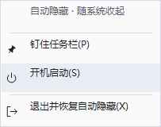
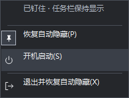

# TaskbarPin 任务栏钉子

一个 Windows 任务栏小工具：在任务栏“自动隐藏”模式下，用一枚 PinWin 风格的小钉子图标把任务栏钉住；再点一下钉子即可恢复自动隐藏。就这一个效果，无依赖、单文件、便携。

## 功能

- 单击系统托盘钉子，在“钉住任务栏（禁止自动隐藏）”与“恢复自动隐藏”之间切换。
- 右键菜单提供钉住/恢复、开机自启和退出；退出时恢复自动隐藏。
- Explorer 重建任务栏后，程序重新显示托盘图标并同步状态。

## 运行环境

- Windows 10 / 11
- .NET Framework 4.x（系统自带，无需安装）

应用仅控制主任务栏 `Shell_TrayWnd`；收起方向按系统报告的停靠位置计算。程序采用系统 DPI 感知，显示设置变化后重新读取系统提供的缩放比例。Windows 11 的新托盘图标可能位于 `^` 溢出区，可手动将其拖到常驻区。

历史交互实测覆盖 Windows 11 24H2，本轮回归运行于 Windows 11（Build 26300）。混合 DPI、多显示器与 Windows 10 顶部或侧边任务栏仍需实机验证。

## 配置与诊断

`debug.log` 默认位于程序目录；程序目录不可写或日志文件只读时，改用 `%LOCALAPPDATA%\TaskbarPin\`。旧版本留下的 `config.ini` 不再读取。

日志每分钟最多写入一次同类错误，当前日志达到 256 KiB 后轮转到 `debug.log.1`。

## 编译

无需任何第三方依赖，直接用系统自带的 csc。推荐使用构建脚本，它会重新生成图标资源并把图标嵌入 EXE（资源管理器、快捷方式、Alt-Tab 才会显示图标）：

```powershell
powershell -NoProfile -ExecutionPolicy Bypass -File build.ps1          # 输出 bin\TaskbarPin.exe
powershell -NoProfile -ExecutionPolicy Bypass -File build.ps1 -Output C:\path\TaskbarPin.exe
powershell -NoProfile -ExecutionPolicy Bypass -File build.ps1 -SkipAssets   # 使用已有 assets\TaskbarPin.ico
```

仍然支持原来的单文件编译（得到的 EXE 功能相同，但没有嵌入图标）：

```bat
%WINDIR%\Microsoft.NET\Framework64\v4.0.30319\csc.exe /nologo /optimize+ /target:winexe /out:TaskbarPin.exe src\TaskbarPin.cs
```

## 图标与界面


| 浅色 · 自动隐藏 | 深色 · 已钉住 |
| --- | --- |
|  |  |

菜单支持方向键、Enter 和 Esc；菜单打开后可用 P 切换钉住、S 切换开机启动、X 退出。

- `assets/TaskbarPin.ico`（16–256px，9 档，32 位 ARGB）与 `assets/TaskbarPin.png` 由 `tools/IconAssetBuilder.cs` 用与运行时托盘徽标相同的矢量几何绘制，不是位图缩放；`build.ps1` 会重新生成。
- 右键菜单：顶部为状态行（已钉住 / 自动隐藏），统一图标列，菜单字体与间距遵循系统菜单字体和 DPI。
- 主题：托盘徽标跟随“系统（任务栏）”主题，菜单跟随“应用”主题，二者独立读取；高对比度模式改用系统颜色，并保留图标形状区分状态。
- 检查界面：`tests\Render.cs` 把真实菜单与全部图标尺寸渲染为 PNG（浅色/深色/高对比度），渲染时注入调色板，不修改任何系统设置。

## 测试

```powershell
powershell -NoProfile -ExecutionPolicy Bypass -File build.ps1 -Test
```

测试需要运行着 Explorer 的交互式 Windows 桌面。脚本通过临时目录中的构建副本运行 `Tests`、`UiTests`、`RobustnessTests` 和 `RepairTests`，测试结束时恢复自动隐藏设置和光标位置。自启动回归使用独立临时注册表键；托盘重建通过系统消息模拟。

## 使用

直接运行 `TaskbarPin.exe`。命令行也支持：

- `TaskbarPin.exe --pin`：钉住任务栏
- `TaskbarPin.exe --unpin`：恢复自动隐藏并立即收起

参数忽略大小写。无效参数返回退出码 `2`，用法写入诊断日志。系统启动项指向旧路径时，点击开机启动菜单会登记当前路径。

## 实现要点

- `SHAppBarMessage(ABM_SETSTATE)` 切换 `ABS_AUTOHIDE` / `ABS_ALWAYSONTOP`
- 不可见窗体作为消息宿主，由独立 `ApplicationContext` 管理，界面只有 `NotifyIcon`。
- 收到 `TaskbarCreated` 广播时清空任务栏缓存，重新同步状态并显示托盘图标。
- 空闲时每 50 ms 轮询，其中自动隐藏状态每 500 ms 查询一次；仅在收起期间以 16 ms 查询任务栏几何。
- 取消钉住时通过“触碰-移开”鼠标序列与焦点脉冲触发资源管理器原生收起动画。全屏前台跳过焦点脉冲，收起等待最多持续约 1.1 秒。
